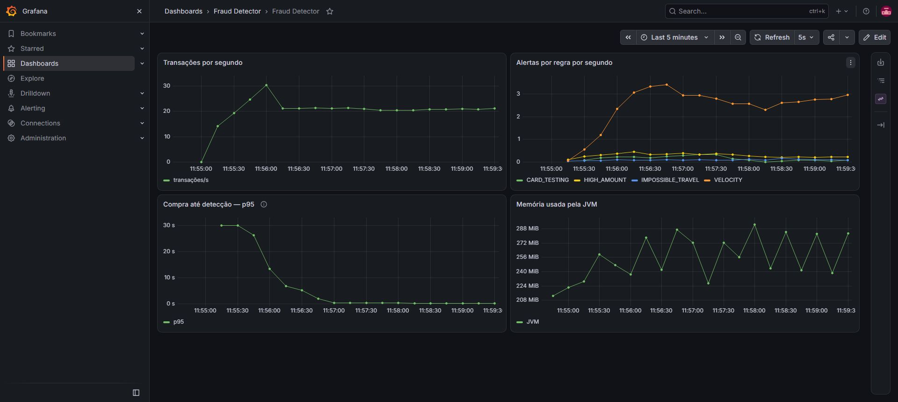
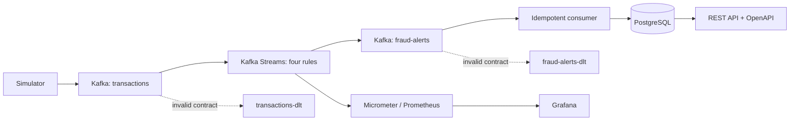
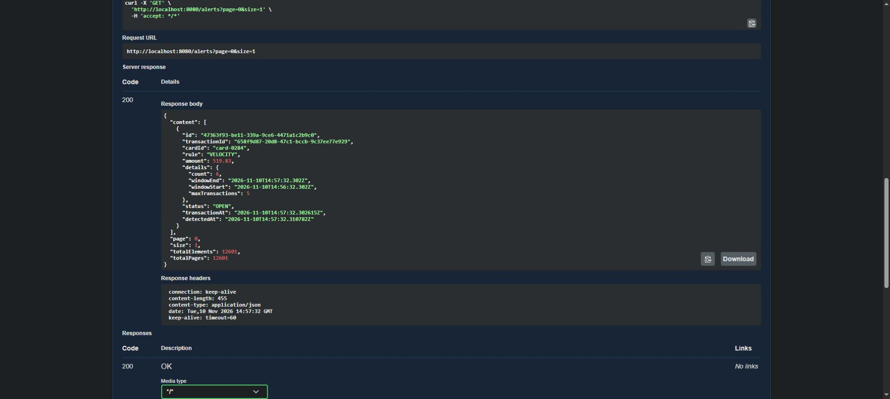
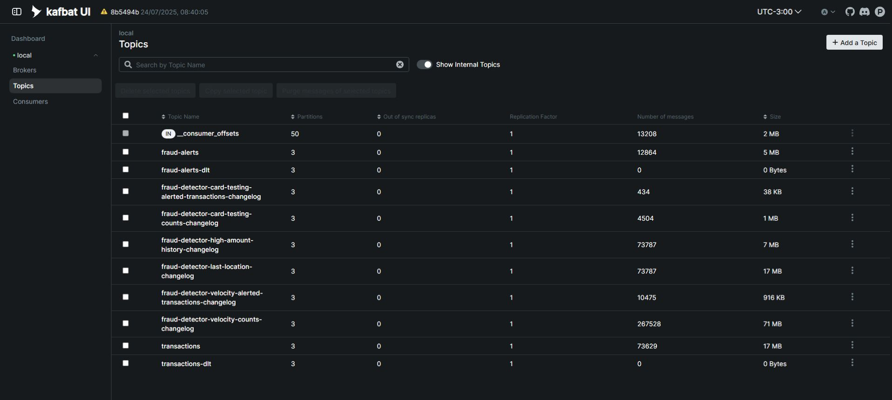

<div align="center">

<h1>Fraud Detector</h1>
<p><strong>Real-time fraud detection, from event to alert.</strong></p>
<p>Java 21 · Kafka Streams · PostgreSQL · Prometheus & Grafana</p>

<p><a href="README.md">🇧🇷 Ler em Português</a> · <strong>🇺🇸 English</strong></p>

<p>
  <a href="https://github.com/Thg1zZ/FraudDetector/actions/workflows/ci.yml"></a>
  
  
  
  <a href="LICENSE"></a>
</p>

<p><a href="#demo">Visual demo</a> · <a href="#architecture">Architecture</a> · <a href="#run">Getting started</a> · <a href="#tests">Tests</a></p>

</div>

---

A purchase enters Kafka, passes through **four stateful rules**, and may become an alert.
The alert is persisted and exposed through a REST API for investigation and classification.

The project demonstrates the entire path: **event time and sliding windows → changelog recovery →
idempotent persistence → API → observability**, tested against real Kafka and PostgreSQL instances.

> **54 tests** · **94.9% detector line coverage** · **4 detection rules** · **MIT license**
>
> Evidence recorded on November 10, 2026. Synthetic data only: `cardId` identifies a fictional profile,
> with no card numbers or personal data. Local demonstration without authentication.

## Contents

- [Visual demo](#demo)
- [How the flow works](#flow)
- [Architecture](#architecture)
- [Detection rules](#rules)
- [API in action](#api)
- [Getting started](#run)
- [Tests and evidence](#tests)
- [Security and engineering decisions](#security)
- [Observability](#observability)
- [Known limitations and next steps](#limits)
- [License](#license)

---

<a id="demo"></a>

## Visual demo



*Actual screenshot of the local demonstration. The charts show synthetic traffic, not maximum production capacity.
The application screenshots are in Portuguese.*

---

<a id="flow"></a>

## How the flow works

1. The simulator publishes normal purchases and suspicious scenarios, using `cardId` as the Kafka key.
2. The detector maintains each card's history and applies four rules.
3. Alerts reach PostgreSQL with protection against repeated and concurrent deliveries.
4. An analyst inspects the evidence and classifies alerts through the REST API.
5. Prometheus and Grafana track the flow. Invalid messages are sent to quarantine topics.

---

<a id="architecture"></a>

## Architecture



| Component | Choice and rationale |
|---|---|
| Java 21 / Spring Boot 4.1.2 | Records for contracts, typed configuration, and validation |
| Kafka Streams 4.2.2 | Key-based aggregation, event time, RocksDB, and changelog recovery |
| PostgreSQL 17 / Flyway | Persistence with uniqueness constraints and tested migrations |
| Micrometer / Prometheus / Grafana | Rates, delay distribution, and memory usage |
| JUnit / TopologyTestDriver / Testcontainers | Deterministic rules and real infrastructure integration |
| Maven / GitHub Actions / JaCoCo | Verifiable builds, CI, and measured coverage |

The modules are `simulator/` and `detector/`. The detector is organized into `transaction`, `stream`,
`rule`, `alert`, and `config`. The API uses DTOs rather than exposing JPA entities. JSON messages do not
depend on Java class headers. Business and quarantine topics have three partitions each.

---

<a id="rules"></a>

## Detection rules

| Rule | Default condition | State used |
|---|---|---|
| `VELOCITY` | More than 5 purchases within 60 seconds | Sliding window |
| `HIGH_AMOUNT` | Amount greater than 5 × the average of at least 5 previous purchases | Sum and count per card |
| `IMPOSSIBLE_TRAVEL` | Travel requiring a speed above 900 km/h | Last location and Haversine distance |
| `CARD_TESTING` | At least 5 purchases with amounts below BRL 5 within 120 seconds | Small-purchase window |

Windows include both boundaries and allow a 30-second grace period after their end, measured by the stream time
**of each aggregation**. The small-purchase rule only receives events below its amount threshold.
The average and location rules ignore events older than the latest known timestamp; they do not recompute
history retroactively. Events with identical timestamps follow arrival order.

Thresholds live in [`application.yml`](detector/src/main/resources/application.yml) and accept environment
overrides, such as `FRAUD_RULES_VELOCITY_MAX_TRANSACTIONS=8`.

---

<a id="api"></a>

## API in action



| Method | Route | Purpose |
|---|---|---|
| `GET` | `/alerts` | Combined `rule`, `status`, and `cardId` filters; pagination |
| `GET` | `/alerts/{id}` | Details, rule, evidence, and timestamps |
| `PATCH` | `/alerts/{id}/status` | Classify as `CONFIRMED` or `FALSE_POSITIVE` |
| `GET` | `/swagger-ui/index.html` | Interactive documentation |
| `GET` | `/actuator/health` | Application health |
| `GET` | `/actuator/prometheus` | Metrics |

```bash
curl 'http://localhost:8080/alerts?rule=VELOCITY&status=OPEN&size=5'
curl 'http://localhost:8080/alerts/ALERT_UUID'
curl -X PATCH 'http://localhost:8080/alerts/ALERT_UUID/status' \
  -H 'Content-Type: application/json' -d '{"status":"CONFIRMED"}'
```

The list response contains `content`, `page`, `size`, `totalElements`, and `totalPages`, ordered by detection
time descending, with ID as the tie-breaker. Limits are 100 items per page and page indices from 0 to 10,000.
Contract errors return `400` with Problem Details; missing resources return `404`.

---

<a id="run"></a>

## Getting started

Requirements: **JDK 21**, Docker running Linux containers, and access to Maven Central/Docker Hub on the first run.
The Maven Wrapper is included. On Windows, replace `bash mvnw` with `.\mvnw.cmd`.

### 1. Validate the project

```bash
bash mvnw --batch-mode --no-transfer-progress clean verify
```

This compiles both modules, runs the tests, and starts temporary Kafka and PostgreSQL instances through
Testcontainers. No `.env`, Compose file, or pre-existing database is required. Containers use random ports
and are removed afterward; the demonstration database is not used.

### 2. Start Kafka and PostgreSQL for the application

<details>
<summary><strong>Show local infrastructure commands</strong></summary>

The commands below use Bash. Set a local password in the same session that will run the detector:

```bash
read -rsp 'Local PostgreSQL password: ' POSTGRES_PASSWORD; echo
export POSTGRES_PASSWORD

docker run -d --name fraud-postgres -p 127.0.0.1:5432:5432 \
  -e POSTGRES_DB=fraud -e POSTGRES_USER=fraud -e POSTGRES_PASSWORD \
  -v fraud-demo-postgres:/var/lib/postgresql/data postgres:17-alpine

docker run -d --name fraud-kafka -p 127.0.0.1:9092:9092 \
  -e KAFKA_NODE_ID=1 -e KAFKA_PROCESS_ROLES=broker,controller \
  -e KAFKA_LISTENERS=PLAINTEXT://:9092,CONTROLLER://:9093 \
  -e KAFKA_ADVERTISED_LISTENERS=PLAINTEXT://localhost:9092 \
  -e KAFKA_CONTROLLER_LISTENER_NAMES=CONTROLLER \
  -e KAFKA_LISTENER_SECURITY_PROTOCOL_MAP=CONTROLLER:PLAINTEXT,PLAINTEXT:PLAINTEXT \
  -e KAFKA_CONTROLLER_QUORUM_VOTERS=1@localhost:9093 \
  -e KAFKA_OFFSETS_TOPIC_REPLICATION_FACTOR=1 \
  -e KAFKA_TRANSACTION_STATE_LOG_REPLICATION_FACTOR=1 \
  -e KAFKA_TRANSACTION_STATE_LOG_MIN_ISR=1 \
  -e KAFKA_AUTO_CREATE_TOPICS_ENABLE=false apache/kafka:4.1.0

docker exec fraud-postgres pg_isready -U fraud -d fraud
docker exec fraud-kafka /opt/kafka/bin/kafka-broker-api-versions.sh --bootstrap-server localhost:9092
```

Wait for the last two commands to succeed. In PowerShell, set `$env:POSTGRES_PASSWORD` before starting
the detector and adapt Docker command line continuations. Ports 5432 and 9092 must be available;
run only one demonstration infrastructure at a time.

</details>

### 3. Start the detector and simulator

In the session with `POSTGRES_PASSWORD` set:

```bash
java -jar detector/target/detector-0.0.1-SNAPSHOT.jar
```

In another terminal:

```bash
java -jar simulator/target/simulator-0.0.1-SNAPSHOT.jar
```

Open [Swagger UI](http://localhost:8080/swagger-ui/index.html) or query
[open alerts](http://localhost:8080/alerts?status=OPEN&size=5). Flyway creates the table and the detector declares the topics.

| Variable | Default / purpose |
|---|---|
| `POSTGRES_PASSWORD` | Required; supplied through the environment |
| `POSTGRES_URL` | `jdbc:postgresql://localhost:5432/fraud` |
| `POSTGRES_USER` | `fraud` |
| `KAFKA_BOOTSTRAP_SERVERS` | `localhost:9092` |
| `KAFKA_STREAMS_STATE_DIR` | `./.state/detector`; use persistent storage |
| `SERVER_ADDRESS` | `127.0.0.1`; local HTTP access by default |
| `SIMULATOR_TRANSACTIONS_PER_SECOND` | `20` scenario selections per second |
| `SIMULATOR_CARDS` | `500` synthetic profiles |
| `SIMULATOR_FRAUD_RATE` | `0.01`; probability between 0 and 1 |

Stop the infrastructure with `docker stop fraud-kafka fraud-postgres`. The PostgreSQL volume is preserved.
Kafka in this example is ephemeral; configure persistent storage to retain history across container recreation.

---

<a id="tests"></a>

## Tests and evidence

Validation on **November 10, 2026**, from a clean build: **54 tests, zero failures and zero skipped**.

| Layer | Tests | What they demonstrate |
|---|---:|---|
| Simulator | 6 | Synthetic scenarios and invalid configuration rejection |
| Topology | 28 | Four rules, window boundaries, lateness, card isolation, metrics, and quarantine |
| Contracts and deserialization | 6 | Monetary limits, exponent overflow, timestamps, coordinates, and clock skew tolerance |
| Integration | 14 | Real Kafka/PostgreSQL, Flyway, API, concurrency, recovery, and LZ4/Snappy compression |

Recovery tests stop Streams, remove only its temporary local state, and verify changelog restoration before
completing a suspicious sequence. Quarantine tests insert invalid and valid messages into the **same partition**,
verify DLT contents, and confirm that processing continues. Tests with a real broker use recent events to
respect changelog retention; topology unit tests use a fixed clock.
HTTP tests cover invalid parameters, injection treated as data, updates restricted to status,
unsupported content types, and the absence of CORS access for external origins.

```bash
bash mvnw test       # unit tests; Docker not required
bash mvnw verify     # includes integration; requires Docker
```

| JaCoCo coverage | Lines | Branches |
|---|---:|---:|
| Detector | 94.9% (241/254) | 72.9% (121/166) |
| Simulator | 74.6% (53/71) | 95.0% (19/20) |

HTML reports: `detector/target/site/jacoco/index.html` and `simulator/target/site/jacoco/index.html`.
Coverage shows exercised code, not the absence of defects. The simulator's scheduled publisher is not covered
by an automated integration test; it was verified in the running demonstration.

The [CI workflow](.github/workflows/ci.yml) runs `verify` on Ubuntu with Java 21 and uploads the reports;
actions are pinned to commit SHAs. [Dependabot](.github/dependabot.yml) checks Maven and GitHub Actions weekly.
The coverage numbers above come from the local run. Remote runs and their reports are available under
the repository's [Actions tab](https://github.com/Thg1zZ/FraudDetector/actions).

---

<a id="security"></a>

## Security and engineering decisions

This is a **local demonstration without authentication**. Keep the API bound to loopback.
Public deployment requires authentication/authorization, TLS, and traffic controls for Kafka and the database too.

The review used [OWASP Top 10 2025](https://owasp.org/Top10/2025/)
and [OWASP API Security Top 10 2023](https://owasp.org/API-Security/editions/2023/en/0x11-t10/) as references.
The measures below can be checked in source and tests; they are not an OWASP certification.

| Boundary | Protection |
|---|---|
| Kafka input | Fixed JSON types; producer-supplied Java class headers are ignored |
| Event time | Events more than one minute in the future are rejected before advancing window stream time |
| Amounts | Positive values, up to two decimal places and 17 integer digits; no silent rounding |
| Invalid records | `transactions-dlt` or `fraud-alerts-dlt`; subsequent processing continues |
| Persistence | Parameterized SQL and `(transaction_id, rule)` uniqueness; duplicates preserve classification |
| ID collision | Reusing an alert ID for another transaction/rule is rejected |
| REST | Update DTO, validated enums, bounded pagination, and errors without stack traces |
| Configuration | Environment-based passwords, local bind address, and only health/info/prometheus exposed by Actuator |
| Dependencies | OSV query for 115 runtime artifacts on November 10, 2026; no advisories returned after updates |

`at.yawk.lz4:lz4-java` was updated to **1.11.4** and `org.xerial.snappy:snappy-java` to **1.1.10.9**,
following the [LZ4 advisories](https://github.com/yawkat/lz4-java/security/advisories)
and [Snappy advisories](https://github.com/xerial/snappy-java/security/advisories).
A known-advisory query is a snapshot, not a future guarantee; it does not cover container images.

Transient persistence failures are retried indefinitely. Contract errors go to a DLT; the alert consumer
only completes recovery after quarantine publication is confirmed. There is no automatic DLT replay:
inspect the cause, fix the contract, and perform a controlled replay. DLTs may contain business data
and need the same access and retention controls as their source topics.

---

<a id="observability"></a>

## Observability



The dashboard in the first screenshot has four panels. Recreate them in Grafana with Prometheus:

| Panel | PromQL |
|---|---|
| Transactions/s | `sum(rate(fraud_transactions_total[1m]))` |
| Alerts/s by rule | `sum by (rule) (rate(fraud_alerts_total[1m]))` |
| Purchase-to-detection p95 | `histogram_quantile(0.95, sum by (le) (rate(fraud_detection_latency_seconds_bucket[5m])))` |
| JVM memory | `sum(jvm_memory_used_bytes)` |

Configure Prometheus to scrape `/actuator/prometheus` every 5 seconds. When running on the host,
Prometheus must be able to reach `127.0.0.1:8080`. In a container network, use `detector:8080`, set
`SERVER_ADDRESS=0.0.0.0` **inside the container**, and publish only `127.0.0.1:8080:8080` on the host.
The Grafana data source points to Prometheus. The screenshots use Kafka UI, Prometheus, and Grafana
in locally provisioned containers.

Docker/Compose files, local dashboards, `.env`, and agent configuration are not included in the repository.
The instructions above, both READMEs, and selected screenshots are public.

The p95 measures **event-to-detection time**, including delivery and backlog; it is not rule CPU time.
Events within the allowed future skew have their duration clamped to zero. Counters measure observed
processing and may include reprocessing. Scenarios can generate several purchases, so the transaction
rate may exceed the configured 20 scenario selections/s. No saturation benchmark has been performed.

---

<a id="limits"></a>

## Known limitations and next steps

- Kafka processing is `at_least_once`. Alert persistence is idempotent; counters and rule history
  do not provide global deduplication of business transactions duplicated at the source.
- The average uses accumulated history; average/location stores have no TTL. Many cards or long runs
  require a business-defined history horizon and retention policy.
- Rules are heuristics; there is no trained model, precision/recall evaluation, or payment blocking.
- The demonstration uses one broker and replication factor 1. High availability, ACLs, TLS, and disaster
  recovery require a different configuration.
- Authentication, classification audit trails, and role-based authorization are next steps for multi-user use.

---

<a id="license"></a>

## License

This project is distributed under the [MIT license](LICENSE).

Copyright © 2026 [Thiago Gomes](https://github.com/Thg1zZ).

<p align="center"><a href="#fraud-detector">Back to top ↑</a> · <a href="README.md">Ler em Português →</a></p>
