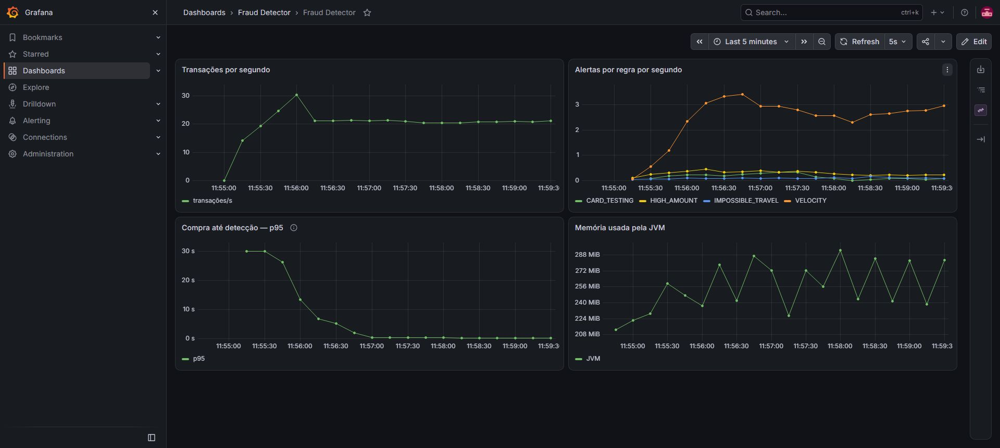
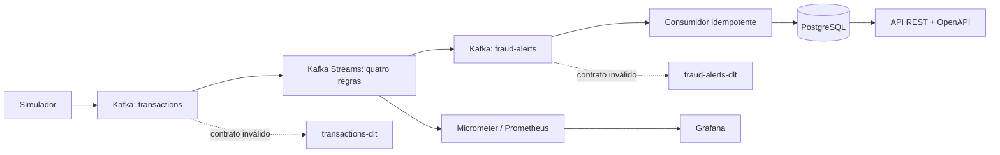
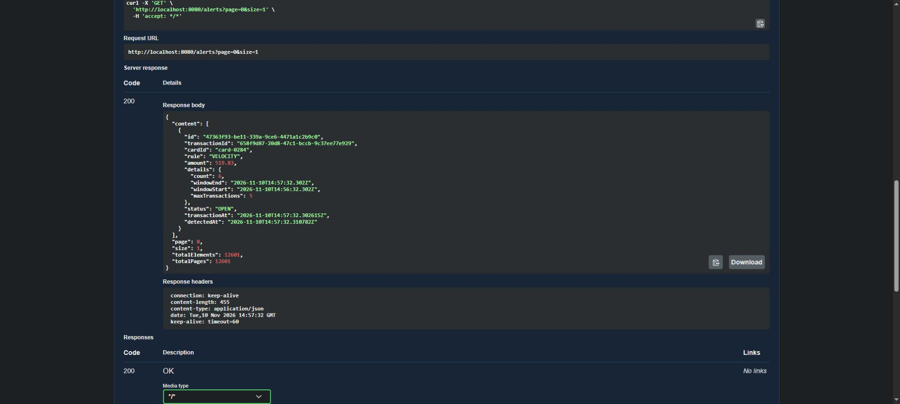
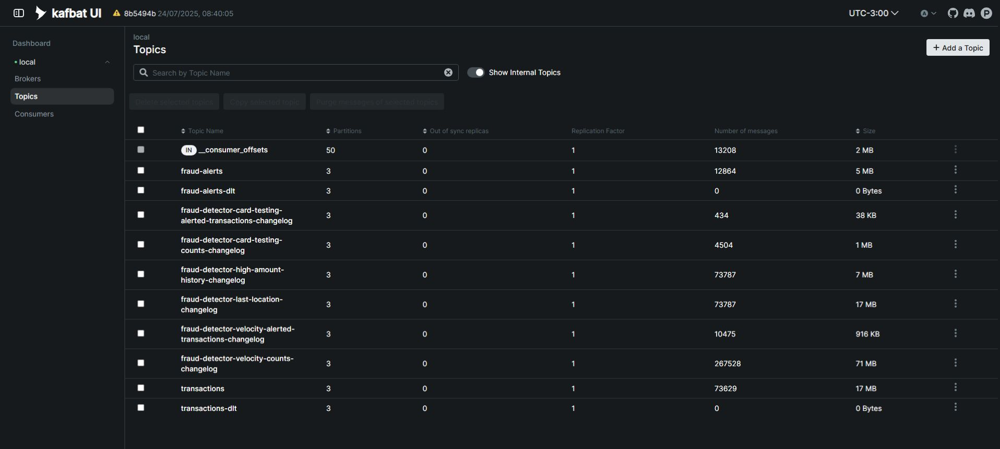

<div align="center">

<h1>Fraud Detector</h1>
<p><strong>Detecção de fraude em tempo real, do evento ao alerta.</strong></p>
<p>Java 21 · Kafka Streams · PostgreSQL · Prometheus & Grafana</p>

<p><strong>🇧🇷 Português</strong> · <a href="README.en.md">🇺🇸 Read in English</a></p>

<p>
  <a href="https://github.com/Thg1zZ/FraudDetector/actions/workflows/ci.yml"></a>
  
  
  
  <a href="LICENSE"></a>
</p>

<p><a href="#demo">Demo visual</a> · <a href="#architecture">Arquitetura</a> · <a href="#run">Como rodar</a> · <a href="#tests">Testes</a></p>

</div>

---

Uma compra entra no Kafka, passa por **quatro regras com estado** e pode virar um alerta.
O alerta é persistido e fica disponível para consulta e classificação pela API REST.

O diferencial é demonstrar o caminho completo: **event time e janelas deslizantes → recuperação pelo
changelog → persistência idempotente → API → observabilidade**, com testes em Kafka e PostgreSQL reais.

> **54 testes** · **94,9% de cobertura de linhas no detector** · **4 regras de detecção** · **licença MIT**
>
> Evidências de 10/11/2026. Somente dados sintéticos: `cardId` identifica um perfil fictício,
> sem número de cartão ou dados pessoais. Demonstração local, sem autenticação.

## Sumário

- [Demo visual](#demo)
- [Como o fluxo funciona](#flow)
- [Arquitetura](#architecture)
- [Regras de detecção](#rules)
- [API em funcionamento](#api)
- [Como rodar](#run)
- [Testes e evidências](#tests)
- [Segurança e decisões de engenharia](#security)
- [Observabilidade](#observability)
- [Limites conhecidos e evolução](#limits)
- [Licença](#license)

---

<a id="demo"></a>

## Demo visual



*Captura da demonstração local. Os gráficos mostram tráfego sintético; não representam capacidade máxima de produção.*

---

<a id="flow"></a>

## Como o fluxo funciona

1. O simulador publica compras normais e cenários suspeitos, usando `cardId` como chave Kafka.
2. O detector mantém o histórico de cada cartão e aplica quatro regras.
3. Os alertas chegam ao PostgreSQL com proteção contra entregas repetidas e concorrentes.
4. Um analista consulta evidências e classifica os alertas pela API REST.
5. Prometheus e Grafana acompanham o fluxo. Mensagens inválidas seguem para quarentena.

---

<a id="architecture"></a>

## Arquitetura



| Componente | Escolha e motivo |
|---|---|
| Java 21 / Spring Boot 4.1.2 | Records para contratos, configuração tipada e validação |
| Kafka Streams 4.2.2 | Agregação por chave, event time, RocksDB e recuperação por changelog |
| PostgreSQL 17 / Flyway | Persistência com unicidade e migração validada em testes |
| Micrometer / Prometheus / Grafana | Taxas, distribuição de atraso e uso de memória |
| JUnit / TopologyTestDriver / Testcontainers | Regras determinísticas e integração com infraestrutura real |
| Maven / GitHub Actions / JaCoCo | Build verificável, CI e cobertura mensurada |

Os módulos são `simulator/` e `detector/`. O detector organiza o código em `transaction`, `stream`,
`rule`, `alert` e `config`. A API usa DTOs e não expõe entidades JPA. Mensagens JSON não dependem
de cabeçalhos de classe Java. Os tópicos de negócio e de quarentena têm três partições cada.

---

<a id="rules"></a>

## Regras de detecção

| Regra | Condição padrão | Histórico usado |
|---|---|---|
| `VELOCITY` | Mais de 5 compras em 60 segundos | Janela deslizante |
| `HIGH_AMOUNT` | Valor maior que 5 × a média de pelo menos 5 compras anteriores | Soma e contagem por cartão |
| `IMPOSSIBLE_TRAVEL` | Deslocamento que exige mais de 900 km/h | Última localização e distância Haversine |
| `CARD_TESTING` | Pelo menos 5 compras de valor menor que R$ 5 em 120 segundos | Janela de pequenas compras |

As janelas incluem os extremos e têm 30 segundos de tolerância após seu término, medidos pelo stream time
**de cada agregação**. A regra de pequenas compras recebe somente eventos abaixo do limite de valor.
As regras de média e localização ignoram eventos anteriores ao último horário conhecido; não recalculam
retroativamente o histórico. Eventos com o mesmo horário seguem a ordem de chegada.

Os limites ficam em [`application.yml`](detector/src/main/resources/application.yml) e aceitam overrides
por ambiente, por exemplo `FRAUD_RULES_VELOCITY_MAX_TRANSACTIONS=8`.

---

<a id="api"></a>

## API em funcionamento



| Método | Rota | Uso |
|---|---|---|
| `GET` | `/alerts` | Filtros combinados `rule`, `status`, `cardId`; paginação |
| `GET` | `/alerts/{id}` | Detalhes, regra, evidências e horários |
| `PATCH` | `/alerts/{id}/status` | Classificar como `CONFIRMED` ou `FALSE_POSITIVE` |
| `GET` | `/swagger-ui/index.html` | Documentação interativa |
| `GET` | `/actuator/health` | Saúde da aplicação |
| `GET` | `/actuator/prometheus` | Métricas |

```bash
curl 'http://localhost:8080/alerts?rule=VELOCITY&status=OPEN&size=5'
curl 'http://localhost:8080/alerts/UUID_DO_ALERTA'
curl -X PATCH 'http://localhost:8080/alerts/UUID_DO_ALERTA/status' \
  -H 'Content-Type: application/json' -d '{"status":"CONFIRMED"}'
```

A listagem retorna `content`, `page`, `size`, `totalElements` e `totalPages`, ordenados por detecção
decrescente e ID como desempate. São permitidos até 100 itens por página e páginas de 0 a 10.000.
Erros de contrato retornam `400` em Problem Details; recurso inexistente retorna `404`.

---

<a id="run"></a>

## Como rodar

Pré-requisitos: **JDK 21**, Docker com containers Linux e acesso ao Maven Central/Docker Hub na primeira execução.
O Maven Wrapper está incluído. No Windows, substitua `bash mvnw` por `.\mvnw.cmd`.

### 1. Validar o projeto

```bash
bash mvnw --batch-mode --no-transfer-progress clean verify
```

Compila os módulos, executa os testes e inicia Kafka e PostgreSQL temporários via Testcontainers.
Não exige `.env`, Compose ou banco previamente criado. Os containers usam portas aleatórias e são
removidos ao final; o banco da demonstração não é utilizado.

### 2. Subir Kafka e PostgreSQL para a aplicação

<details>
<summary><strong>Ver comandos de infraestrutura local</strong></summary>

Os comandos abaixo usam Bash. Defina uma senha local na sessão em que iniciará o detector:

```bash
read -rsp 'Senha local do PostgreSQL: ' POSTGRES_PASSWORD; echo
export POSTGRES_PASSWORD

docker run -d --name fraud-postgres -p 127.0.0.1:5432:5432 \
  -e POSTGRES_DB=fraud -e POSTGRES_USER=fraud -e POSTGRES_PASSWORD \
  -v fraud-demo-postgres:/var/lib/postgresql/data postgres:17-alpine

docker run -d --name fraud-kafka -p 127.0.0.1:9092:9092 \
  -e KAFKA_NODE_ID=1 -e KAFKA_PROCESS_ROLES=broker,controller \
  -e KAFKA_LISTENERS=PLAINTEXT://:9092,CONTROLLER://:9093 \
  -e KAFKA_ADVERTISED_LISTENERS=PLAINTEXT://localhost:9092 \
  -e KAFKA_CONTROLLER_LISTENER_NAMES=CONTROLLER \
  -e KAFKA_LISTENER_SECURITY_PROTOCOL_MAP=CONTROLLER:PLAINTEXT,PLAINTEXT:PLAINTEXT \
  -e KAFKA_CONTROLLER_QUORUM_VOTERS=1@localhost:9093 \
  -e KAFKA_OFFSETS_TOPIC_REPLICATION_FACTOR=1 \
  -e KAFKA_TRANSACTION_STATE_LOG_REPLICATION_FACTOR=1 \
  -e KAFKA_TRANSACTION_STATE_LOG_MIN_ISR=1 \
  -e KAFKA_AUTO_CREATE_TOPICS_ENABLE=false apache/kafka:4.1.0

docker exec fraud-postgres pg_isready -U fraud -d fraud
docker exec fraud-kafka /opt/kafka/bin/kafka-broker-api-versions.sh --bootstrap-server localhost:9092
```

Aguarde os dois últimos comandos concluírem com sucesso. No PowerShell, defina `$env:POSTGRES_PASSWORD`
antes de iniciar o detector e adapte a continuação de linha dos comandos Docker. As portas 5432 e 9092
precisam estar livres; use uma única infraestrutura de demonstração por vez.

</details>

### 3. Iniciar detector e simulador

Na sessão com `POSTGRES_PASSWORD` definido:

```bash
java -jar detector/target/detector-0.0.1-SNAPSHOT.jar
```

Em outro terminal:

```bash
java -jar simulator/target/simulator-0.0.1-SNAPSHOT.jar
```

Abra [Swagger UI](http://localhost:8080/swagger-ui/index.html) ou consulte
[alertas abertos](http://localhost:8080/alerts?status=OPEN&size=5). Flyway cria a tabela e o detector declara os tópicos.

| Variável | Padrão / finalidade |
|---|---|
| `POSTGRES_PASSWORD` | Obrigatória; fornecida pelo ambiente |
| `POSTGRES_URL` | `jdbc:postgresql://localhost:5432/fraud` |
| `POSTGRES_USER` | `fraud` |
| `KAFKA_BOOTSTRAP_SERVERS` | `localhost:9092` |
| `KAFKA_STREAMS_STATE_DIR` | `./.state/detector`; use um diretório persistente |
| `SERVER_ADDRESS` | `127.0.0.1`; acesso HTTP local por padrão |
| `SIMULATOR_TRANSACTIONS_PER_SECOND` | `20` escolhas de cenário por segundo |
| `SIMULATOR_CARDS` | `500` perfis sintéticos |
| `SIMULATOR_FRAUD_RATE` | `0.01`; probabilidade entre 0 e 1 |

Para parar a infraestrutura: `docker stop fraud-kafka fraud-postgres`. O volume do PostgreSQL é preservado.
O Kafka desse exemplo é temporário; use armazenamento persistente para conservar histórico entre recriações.

---

<a id="tests"></a>

## Testes e evidências

Validação de **10/11/2026**, em build limpo: **54 testes, zero falhas e zero ignorados**.

| Camada | Testes | O que é comprovado |
|---|---:|---|
| Simulador | 6 | Cenários sintéticos e rejeição de configuração inválida |
| Topologia | 28 | Quatro regras, extremos das janelas, atraso, isolamento por cartão, métricas e quarentena |
| Contratos e desserialização | 6 | Limites monetários, overflow de expoente, datas, coordenadas e tolerância de relógio |
| Integração | 14 | Kafka/PostgreSQL reais, Flyway, API, concorrência, recuperação e compressão LZ4/Snappy |

Os testes de recuperação param o Streams, removem apenas seu estado temporário e verificam a restauração
pelo changelog antes de completar uma sequência suspeita. Os testes de quarentena inserem mensagens inválidas
e válidas na **mesma partição**, verificam o conteúdo da DLT e a continuidade do processamento.
Os testes com broker real usam eventos recentes para respeitar a retenção dos changelogs; os testes
unitários da topologia usam relógio fixo.
Os testes HTTP cobrem parâmetros inválidos, injeção tratada como dado, atualização restrita ao status,
conteúdo incompatível e ausência de liberação CORS para origens externas.

```bash
bash mvnw test       # unitários; sem Docker
bash mvnw verify     # inclui integração; requer Docker
```

| Cobertura JaCoCo | Linhas | Decisões (branches) |
|---|---:|---:|
| Detector | 94,9% (241/254) | 72,9% (121/166) |
| Simulador | 74,6% (53/71) | 95,0% (19/20) |

Relatórios HTML: `detector/target/site/jacoco/index.html` e `simulator/target/site/jacoco/index.html`.
Cobertura indica código exercitado; não comprova ausência de defeitos. A publicação agendada do simulador
não é coberta por teste de integração automatizado; foi verificada na demonstração em execução.

O [workflow de CI](.github/workflows/ci.yml) executa `verify` com Java 21 no Ubuntu e disponibiliza os relatórios;
as ações estão fixadas por commit. [Dependabot](.github/dependabot.yml) acompanha Maven e GitHub Actions semanalmente.
Os números de cobertura acima vêm da execução local. As execuções remotas e seus relatórios ficam
na aba [Actions](https://github.com/Thg1zZ/FraudDetector/actions) do repositório.

---

<a id="security"></a>

## Segurança e decisões de engenharia

Esta é uma **demonstração local sem autenticação**. A API deve permanecer no loopback.
Exposição pública exige autenticação/autorização, TLS e controles de tráfego também no Kafka e no banco.

A revisão foi orientada pelo [OWASP Top 10 2025](https://owasp.org/Top10/2025/)
e pelo [OWASP API Security Top 10 2023](https://owasp.org/API-Security/editions/2023/en/0x11-t10/).
As medidas abaixo são verificáveis no código e nos testes; não representam certificação OWASP.

| Fronteira | Proteção aplicada |
|---|---|
| Entrada Kafka | Tipos JSON fixos; cabeçalhos de classe do produtor são ignorados |
| Event time | Mais de um minuto no futuro é rejeitado antes de avançar o relógio das janelas |
| Valores | Valor positivo, até duas casas e 17 dígitos inteiros, sem arredondamento silencioso |
| Registro inválido | `transactions-dlt` ou `fraud-alerts-dlt`; processamento seguinte continua |
| Persistência | SQL parametrizado e unicidade `(transaction_id, rule)`; duplicatas preservam a classificação |
| Colisão de ID | Identificador reutilizado para outra transação/regra é rejeitado |
| REST | DTO de atualização, enums validados, paginação limitada e erros sem stacktrace |
| Configuração | Senhas pelo ambiente, bind local e apenas health/info/prometheus expostos pelo Actuator |
| Dependências | Consulta OSV de 115 artefatos de runtime em 10/11/2026; nenhum aviso retornado após atualizações |

Foram atualizadas `at.yawk.lz4:lz4-java` para **1.11.4** e `org.xerial.snappy:snappy-java` para **1.1.10.9**,
conforme os [avisos LZ4](https://github.com/yawkat/lz4-java/security/advisories)
e [avisos Snappy](https://github.com/xerial/snappy-java/security/advisories).
A consulta a avisos conhecidos é uma fotografia da data, não uma garantia futura; não cobre imagens de containers.

Falhas transitórias de persistência mantêm tentativas sem limite. Erros de contrato seguem para a DLT;
no consumidor de alertas, a recuperação só termina após confirmação da publicação na quarentena.
Não existe replay automático das DLTs: inspecione a causa, corrija o contrato e faça um replay controlado.
Uma DLT pode conter dados de negócio e precisa dos mesmos cuidados de acesso/retenção do tópico original.

---

<a id="observability"></a>

## Observabilidade



O dashboard da primeira captura tem quatro painéis. Para recriá-los no Grafana com Prometheus:

| Painel | PromQL |
|---|---|
| Transações/s | `sum(rate(fraud_transactions_total[1m]))` |
| Alertas/s por regra | `sum by (rule) (rate(fraud_alerts_total[1m]))` |
| Compra até detecção — p95 | `histogram_quantile(0.95, sum by (le) (rate(fraud_detection_latency_seconds_bucket[5m])))` |
| Memória JVM | `sum(jvm_memory_used_bytes)` |

Configure o scrape do Prometheus com caminho `/actuator/prometheus` e intervalo de 5 segundos.
No modo host, Prometheus deve alcançar `127.0.0.1:8080`. Em uma rede de containers, use `detector:8080`,
defina `SERVER_ADDRESS=0.0.0.0` **dentro do container** e publique no host apenas como `127.0.0.1:8080:8080`.
O datasource do Grafana aponta para o Prometheus. A captura usa Kafka UI, Prometheus e Grafana
em containers locais com provisionamento próprio.

Docker/Compose, dashboards locais, `.env` e configurações de agentes não fazem parte do repositório.
As instruções acima, os READMEs, a licença e as capturas selecionadas são públicos.

O p95 mede **tempo do evento até detecção**, incluindo entrega e backlog; não é tempo de CPU da regra.
Eventos dentro da tolerância futura têm duração limitada a zero. Contadores medem processamento observado,
podendo incluir reprocessamentos. Cenários geram mais de uma compra, portanto a taxa efetiva pode ultrapassar
as 20 escolhas de cenário/s configuradas. Não foi realizado benchmark de saturação.

---

<a id="limits"></a>

## Limites conhecidos e evolução

- Kafka opera em `at_least_once`. A escrita de alertas é idempotente; os contadores e o histórico das regras
  não garantem deduplicação global de transações de negócio repetidas na origem.
- A média usa histórico acumulado; os estados de média/localização não têm TTL. Muitos cartões ou períodos
  longos exigem definição de horizonte de negócio e retenção.
- As regras são heurísticas; não há modelo treinado, avaliação de precisão/recall ou bloqueio de pagamento.
- A demonstração usa um broker e replicação 1. Alta disponibilidade, ACLs, TLS e recuperação de desastre exigem outra configuração.
- Autenticação, auditoria das classificações e autorização por função são os próximos passos para uso multiusuário.

---

<a id="license"></a>

## Licença

Este projeto é distribuído sob a [licença MIT](LICENSE).

Copyright © 2026 [Thiago Gomes](https://github.com/Thg1zZ).

<p align="center"><a href="#fraud-detector">Voltar ao topo ↑</a> · <a href="README.en.md">Read in English →</a></p>
